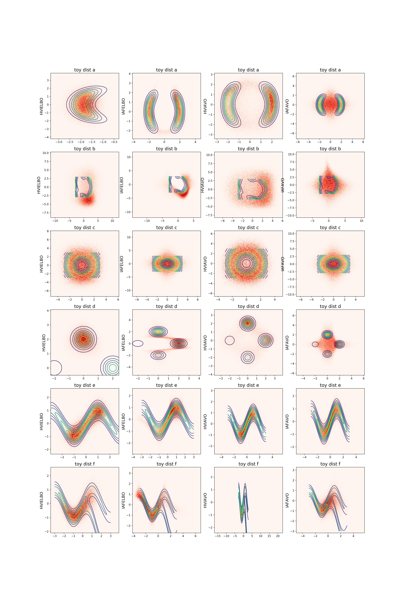
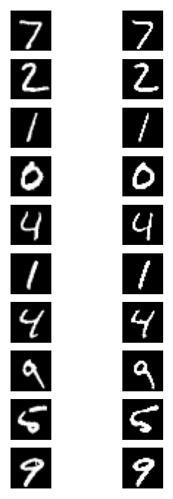

# annealed

Implementación y reproducción del paper "Improving Explorability in Variational Inference with Annealed Variational Objectives Bayesian methods" https://arxiv.org/abs/1809.01818

## Equipo

- Aleksei Pronkin
- Mikhail Kurenkov
- Timur Chikichev
## Propuesta

ver: [Propuesta](Baesian_methods_project_proposal_HVI_AVO.pdf) en este repositorio.

## Reproducción

### Entrenamiento de VAE
Para reproducir los experimentos con VAE, use los siguientes comandos

`
python3 run_vae.py -epoch 100 train vae_hvi
`

El parámetro epoch indica el número de épocas para el entrenamiento. vae_hvi es un modelo posible. Otros modelos posibles son vae, vae_hvi, vae_hvi_avo. Los registros (logs) se guardan en lightning_logs. El punto de control (checkpoint) se guarda en lightning_logs/versrion_{version_number}/checkpoints.

### Evaluación de VAE
Para probar el VAE, use el siguiente comando

`
python run_vae.py -model-checkpoint pretrained_models/vae_hvi_avo.ckpt test vae_hvi_avo
`

Este comando también genera generation.png y reconstruction.png
## Objetivo

Durante este proyecto implementaremos los métodos y repetiremos los experimentos de este paper. https://arxiv.org/abs/1809.01818

## Experimentos

- Modelo de ruido sesgado.
- Ajuste de energía en distribuciones de prueba.
- Análisis cuantitativo sobre la robustez al recocido beta.
- Inferencia amortizada en el conjunto de datos MNIST.

## Resultados

Distribuciones de prueba con recocido:

Experimentos con distribuciones de prueba:

Reconstrucción del VAE. A la izquierda se muestra la verdad subyacente (ground truth) y a la derecha la reconstrucción.

## Modelos

- Autoencoder Variacional (VAE) https://arxiv.org/abs/1312.6114 con parámetros de https://github.com/jmtomczak/vae_householder_flow
- Modelo Variacional Jerárquico (HVM) basado en https://arxiv.org/abs/1511.02386.
- Autoencoder con Ponderación de Importancia (IWAE) basado en https://arxiv.org/abs/1509.00519.

## Pipeline

- Implementar los modelos.
- Implementar el método AVO https://arxiv.org/abs/1809.01818.
- Implementar el método de Inferencia Variacional Jerárquica (HVI) https://arxiv.org/abs/1511.02386.
- Analizar el comportamiento de la función objetivo AVO en ejemplos de prueba.
- Realizar experimentos con VAE y AVO en los conjuntos de datos MNIST y CelebA.

Planificamos utilizar y reescribir parte del código de https://github.com/joelouismarino/iterative_inference/, https://github.com/jmtomczak/vae_householder_flow, https://github.com/AntixK/PyTorch-VAE, https://github.com/haofuml/cyclical_annealing y https://github.com/ajayjain/lmconv. (Suponemos que los dos primeros repositorios se utilizaron en el código de fuente cerrada del paper original)
